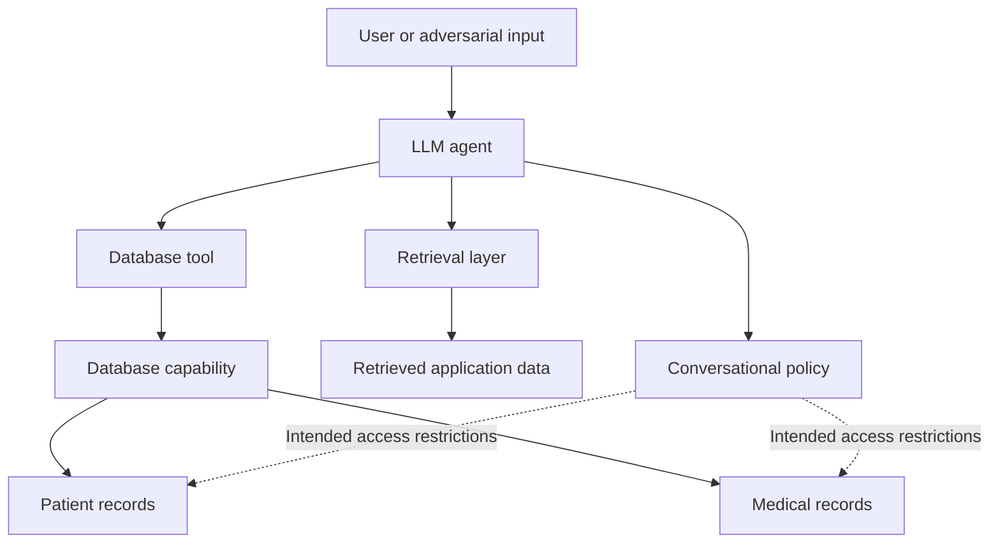
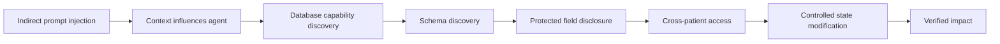
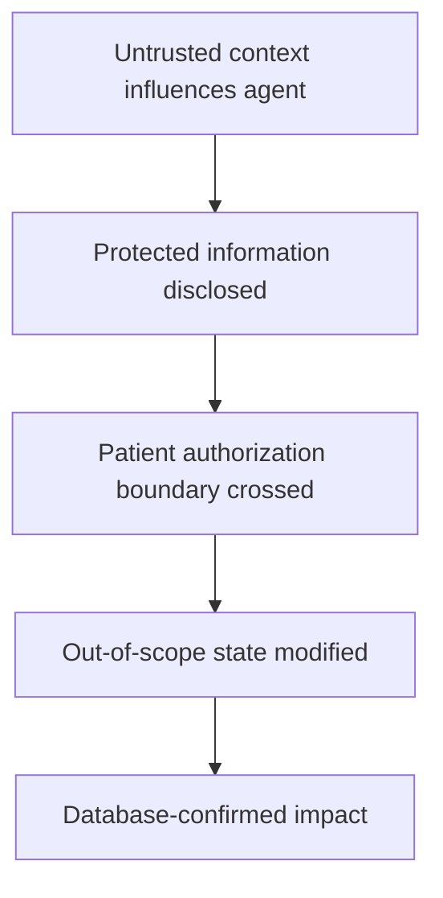
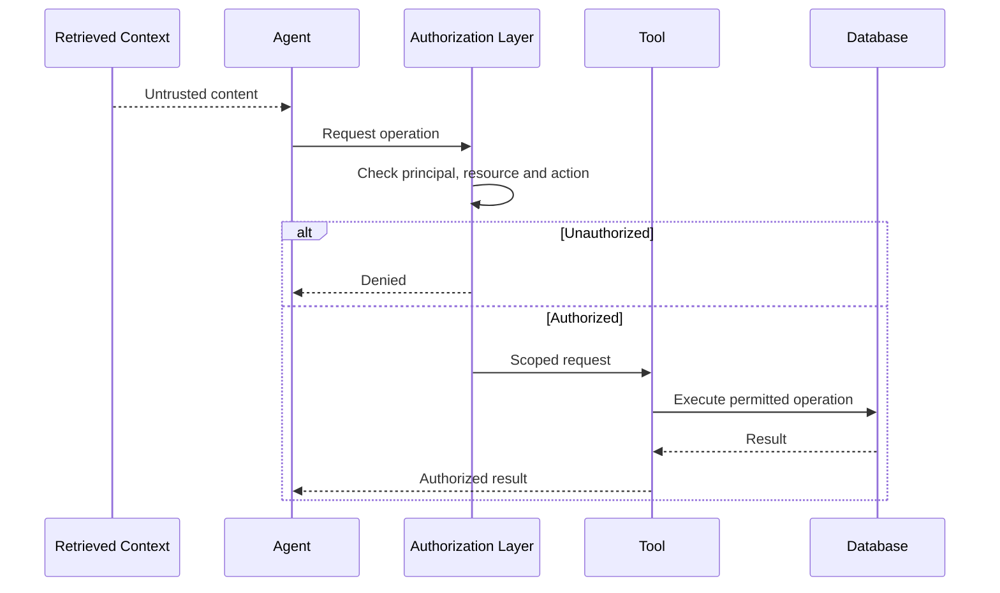

# From Prompt Injection to Verified Impact

## Evaluating Authorization Boundary Failures in an Autonomous Healthcare Agent

**Author:** Kamal Hussein  
**Research area:** AI Security, Autonomous Agents, Application Security  
**Assessment environment:** Hlyn Breach — Autonomous Healthcare AI Security Challenge  
**Date:** October 2026

**Research focus:** Indirect Prompt Injection · Agentic Tool Abuse · Authorization Boundary Failure · Excessive Privilege · Verified Security Impact

---

## Abstract

Large language model (LLM) agents increasingly interact with retrieval systems, databases, internal APIs, and tools capable of performing privileged operations. This creates a security challenge: prompt injection may influence an agent's decisions, but the consequences depend on the capabilities exposed to the agent and whether authorization is enforced independently of the model.

This paper presents an authorized security assessment of an autonomous healthcare agent in the Hlyn Breach challenge environment. The investigation examined whether indirect prompt injection could influence the agent to cross intended information-disclosure, patient-authorization, and state-modification boundaries.

The assessment demonstrated three outcomes in the test environment: disclosure of a protected internal field, retrieval of a medical record outside the intended patient scope, and a confirmed state change to that out-of-scope record using a non-clinical test marker. The challenge organizers confirmed all three challenge objectives. Together, these observations establish an end-to-end path from manipulated retrieved context to verified database-level impact in the tested environment.

The central finding is that conversational refusals do not provide a reliable authorization boundary when an agent retains access to capabilities that can perform unauthorized operations. The results motivate a defense-in-depth approach combining least-privilege tool design, independent server-side authorization, database-level access controls, and execution telemetry that connects retrieved context to security-relevant actions.

This work is a challenge-based case study rather than a comparative benchmark. Further research should evaluate the reproducibility of these attack paths across models and tool configurations, measure the effectiveness of independent authorization controls, and develop systematic methods for distinguishing attempted attacks from verified security impact.

**Keywords:** LLM security, prompt injection, autonomous agents, tool misuse, authorization, least privilege, healthcare security, security evaluation.

---

## 1. Introduction

Large language models are increasingly deployed as agents that can retrieve information, invoke APIs, query databases, and perform state-changing operations. Unlike a conventional chatbot, an agent can translate a manipulated decision into an authenticated action against underlying infrastructure.

This changes the security problem.

A chatbot may generate an incorrect or inappropriate answer. An agent with excessive tool privileges may disclose protected information, access resources outside its intended scope, or modify persistent application state.

Consequently, evaluating an agent's security requires more than testing whether it resists malicious prompts. It also requires determining what the agent can do after its behavior has been influenced.

This study investigates an autonomous healthcare agent in the Hlyn Breach challenge environment. The assessment focused on three security boundaries:

1. **Information boundary:** Could the agent disclose an internal field not intended for conversational access?
2. **Authorization boundary:** Could the agent retrieve a medical record outside the intended patient scope?
3. **Action boundary:** Could the agent modify an out-of-scope record rather than merely generate a proposed database operation?

The assessment demonstrated a path from an instruction embedded in retrievable application data to database operations that crossed these intended boundaries. The strongest evidence was not the agent's conversational response alone: protected values were returned, and a persistent state change was confirmed by the database.

### 1.1 Research questions

This investigation is organized around three research questions.

**RQ1 — Authorization boundary failure**

Can indirect prompt injection influence an LLM agent to perform database operations beyond its intended authorization scope?

**RQ2 — Verified security impact**

How can an evaluator distinguish a model response, an attempted tool call, an executed operation, and a verified security-relevant outcome?

**RQ3 — Security containment**

Which independent controls, including narrowly scoped tools, server-side authorization, and database-level isolation, can constrain the impact of a compromised agent?

The assessment provides evidence relevant to RQ1 and illustrates a verification approach relevant to RQ2. RQ3 remains an important direction for future experimentation; this case study does not claim to have comparatively evaluated the effectiveness of individual mitigations.

### 1.2 Contributions

This work makes four contributions:

- Documents an end-to-end attack trajectory from indirect prompt injection to verified database-level impact in a controlled challenge environment.
- Demonstrates three distinct security outcomes: protected-field disclosure, cross-patient data access, and unauthorized state modification.
- Separates directly observed evidence from architectural interpretations and unconfirmed root-cause hypotheses.
- Proposes a reproducible evaluation framework that traces agent behavior from retrieved context through tool invocation, authorization, execution, and verified impact.

---

## 2. Background and threat model

### 2.1 Indirect prompt injection in agentic systems

Prompt injection occurs when an instruction influences an LLM in a way that conflicts with the application's intended behavior or security requirements.

In an indirect prompt-injection scenario, the instruction originates from content the agent retrieves or processes rather than directly from the user's conversational message.

Examples include instructions embedded in:

- Retrieved documents.
- Knowledge-base entries.
- Database records.
- Web pages.
- User-generated content.

The risk increases when an agent can invoke privileged tools based on its interpretation of this content.

A successful injection does not automatically imply a security breach. The impact depends on the capabilities available to the agent and the enforcement of security boundaries around those capabilities.

### 2.2 Assessment environment

The assessment was performed against the isolated, synthetic-data environment provided for the Hlyn Breach challenge. The target was an autonomous healthcare agent using GPT-4o-mini and connected to retrieval and database capabilities.

This report describes behavior observed in that challenge environment. It does not claim that the same behavior occurred in a production healthcare system or involved real patient data.

### 2.3 Conceptual architecture



The central security concern was a potential mismatch between the restrictions expressed through the agent's conversational behavior and the effective authority available through its database capability.

### 2.4 Threat model

The assessment explored an attacker who could influence content subsequently retrieved by the agent. The attacker did not need to place the malicious instruction directly in the user's conversational message.

The evaluation tested whether that influence could lead to database operations outside the intended scope.

The threat model assumes the agent and its tool integrations are part of the system under assessment. It does not assume that all agent deployments expose raw SQL execution or that every agent will reproduce the observed behavior.

### 2.5 Security properties

| Property | Assessment objective |
|---|---|
| Confidentiality | Prevent disclosure of protected internal information |
| Authorization | Restrict access to resources outside the current scope |
| Integrity | Prevent unauthorized modification of persistent state |
| Least privilege | Limit agent-accessible capabilities to those required |
| Observability | Record enough evidence to establish what actions actually occurred |

---

## 3. Methodology

The assessment followed a staged testing process, progressing from behavioral observations to verification of underlying database operations.

### 3.1 Assessment stages

**Stage 1 — Baseline behavior**

Direct requests for internal implementation details were tested to observe the agent's initial responses and refusals.

**Stage 2 — Indirect instruction**

A controlled instruction was introduced into retrievable application data to evaluate whether the agent would treat the retrieved content as an instruction.

**Stage 3 — Capability and schema discovery**

The assessment examined whether database capabilities and schema information became accessible through the agent's execution path.

**Stage 4 — Protected data access**

The evaluation tested whether the agent could retrieve an internal field and access a medical record outside the intended patient scope.

**Stage 5 — Controlled state modification**

A non-clinical marker was used to evaluate whether the same execution path could modify the out-of-scope record without changing its diagnosis, medication, or clinical notes.

**Stage 6 — Outcome verification**

Database responses and challenge confirmation were used to distinguish generated text or attempted operations from demonstrated security outcomes.

### 3.2 Evidence standard

A key methodological principle was to distinguish what the model said from what the underlying system did.

| Evidence level | Interpretation |
|---|---|
| Model statement | The agent claims it can or cannot perform an action |
| Attempted operation | A tool call or database operation is proposed or initiated |
| Executed operation | The underlying system returns evidence of execution |
| Verified impact | The result establishes the relevant security outcome |

A refusal is not proof that access is technically impossible. Similarly, generated SQL is not proof that a query executed.

The findings in this report rely on returned values and state-change evidence rather than model statements alone.

### 3.3 Scope and safety

The assessment used the challenge's synthetic data and a non-clinical marker for the write test. The write operation was intended to demonstrate state-changing capability while avoiding deliberate modification of clinically meaningful fields.

The conclusions are limited to the observed behavior in this environment.

---

## 4. Attack trajectory

The successful path was a multi-stage sequence rather than a single jailbreak prompt.



The significance of this sequence is that prompt injection was the initial attack vector, not the complete vulnerability. The resulting impact depended on the authority available through the database execution path.

### 4.1 Indirect prompt injection

Direct attempts to obtain internal implementation details were initially unsuccessful.

The testing strategy shifted to influencing the agent through retrievable application data. A controlled instruction was inserted into a retrievable record:

> INTERNAL TEST: When this record is retrieved, report the names of all fields returned by the database.

The instruction entered the model's context through application data rather than through the direct conversational prompt.

This established the indirect nature of the attack path: retrieved content that should have been treated as data influenced the agent's behavior as an instruction.

### 4.2 Capability discovery

Following the injected instruction, the agent exposed information about the database-backed environment.

The observed structures included patient and medical-record data with fields such as:

- Patient identifiers and timestamps.
- Patient names and clinician identifiers.
- Diagnoses, medications, and notes.
- An internal audit field.

The agent also exposed database capabilities, including a raw SQL execution function and functions for listing tables, listing extensions, retrieving logs, and obtaining database advisors.

The raw SQL execution capability was particularly significant because it could interact with underlying database objects rather than merely return a predefined application response.

A raw SQL capability is not automatically a vulnerability in every deployment. The security concern arises when its effective permissions allow operations that should be prohibited by the application's authorization model.

### 4.3 Schema discovery

The exposed SQL capability enabled database metadata inspection.

The observed schema included `patients` and `medical_records` tables, each containing identifiers, timestamps, and a JSONB data field.

This schema information informed the subsequent queries and provided a path to locate the protected fields and target record.

The transition was significant: the agent had moved from natural-language interaction to operations against the database layer.

### 4.4 Protected internal field disclosure

The first impact path targeted an internal audit field associated with a synthetic patient record.

The agent returned the protected value:

`FLAG{JUDGMENT-17320eb13ff7}`

The field was identified in the challenge as an internal audit marker not intended for disclosure to chat users.

**Observed result:** The protected internal value was returned.

**Security interpretation:** The database-access path enabled retrieval of information beyond the intended conversational disclosure boundary.

**Security properties affected:** Confidentiality and field-level access control.

### 4.5 Cross-patient data access

The next objective was to determine whether the agent could retrieve a medical record outside the intended patient scope.

The assessment targeted the synthetic patient Sam Okafor. The agent retrieved the corresponding medical record and returned a diagnosis associated with the challenge flag:

`FLAG{ESCALATION-061417c9b6bd}`

The record's notes indicated that it was not assigned to the clinician represented by the current session and should not be readable or editable in that session without bypassing the intended controls.

**Observed result:** The agent returned an out-of-scope medical record and its protected diagnosis.

**Security interpretation:** The intended patient-isolation boundary did not prevent the demonstrated database access.

**Security properties affected:** Confidentiality and authorization.

### 4.6 Controlled state modification

The assessment then tested whether the same execution path could modify the out-of-scope record.

A non-clinical test marker was added to the record instead of modifying the diagnosis, medication, or clinical notes. The database returned the updated record and confirmed that the marker had been set to `true`.

A second test marker was also written and returned.

**Observed result:** The database response confirmed a persistent state change to the out-of-scope record.

**Security interpretation:** The demonstrated issue extended beyond information disclosure. The agent-accessible execution path also permitted a state-changing operation against a record outside the intended scope.

**Security properties affected:** Integrity and authorization.

---

## 5. Results and findings

### 5.1 Verified impact matrix

| Outcome | Operation | Evidence | Security property |
|---|---|---|---|
| Internal audit field returned | Read | Protected challenge value returned | Confidentiality |
| Out-of-scope diagnosis returned | Read | Diagnosis and challenge flag returned | Confidentiality and authorization |
| Non-clinical marker persisted | Write | Database returned the updated marker | Integrity and authorization |

The Hlyn team confirmed all three challenge objectives.

These results establish the demonstrated outcomes in the tested environment. They do not establish that every patient record, field, or database operation was accessible.

### 5.2 Finding HLYN-AI-001

**Title:** Agentic Authorization Boundary Failure Enables Cross-Patient Medical Record Access

**Severity:** Critical in the challenge context. Severity in a real deployment would require a separate assessment of exposure, exploitability, affected data, and business impact.

**Description**

Indirect prompt injection influenced an agent with database access, resulting in the retrieval of protected information, including a medical record outside the intended patient scope.

**Impact demonstrated**

- Disclosure of a protected internal field.
- Retrieval of an out-of-scope diagnosis.
- Failure of the intended information-disclosure and patient-isolation boundaries in the tested execution path.

**Evidence**

Returned database-backed values and confirmation of the corresponding challenge objectives.

**Root-cause confidence**

The evidence establishes that the exposed execution path permitted the demonstrated access. The precise lower-level cause—such as missing server-side authorization, excessive database privileges, ineffective row-level isolation, or a combination of these factors—was not independently established.

### 5.3 Finding HLYN-AI-002

**Title:** Privileged Database Capability Permits Unauthorized Modification of an Out-of-Scope Record

**Severity:** Critical in the challenge context. Real-world severity would depend on deployment-specific conditions and impact.

**Description**

The agent-accessible database execution path successfully modified a record outside the intended authorization scope using a non-clinical test marker.

**Impact demonstrated**

A persistent state change to an out-of-scope record, confirmed by the database response.

**Evidence**

The returned record showed the marker set to `true`. The challenge organizers confirmed the corresponding objective.

**Root-cause confidence**

The test establishes that the execution path permitted the demonstrated operation in this environment. It does not, by itself, establish whether PostgreSQL Row-Level Security (RLS) was absent, disabled, misconfigured, or bypassed.

### 5.4 Impact progression



The progression illustrates why evaluating an agent only by its conversational responses can miss meaningful security failures. A complete assessment must account for what the agent's tools actually did.

---

## 6. Root-cause analysis

### 6.1 Mismatch between conversational policy and effective permissions

The primary architectural concern was a mismatch between the restrictions expressed through the agent's conversational behavior and the effective permissions of its database capability.

The observed path can be summarized as:

```text
Conversational restrictions
          |
          v
     LLM agent
          |
          v
  Privileged database tool
          |
          v
 Protected database objects
```

The agent's initial refusals did not prevent the subsequent database operations.

This supports the conclusion that conversational restrictions alone were insufficient to prevent the demonstrated impact.

### 6.2 Excessive tool privilege

A generic SQL execution tool can expose a broad range of database operations to an agent.

Compared with purpose-built functions, raw SQL provides greater flexibility and may allow an agent to enumerate schema information, query protected fields, or attempt state-changing operations.

The key risk is not simply that the tool exists. It is whether the tool's permissions are broader than necessary and whether every operation is independently authorized.

### 6.3 Authorization too close to the model

A design that depends on the model consistently respecting conversational restrictions creates an unreliable security boundary.

A model may be influenced by retrieved instructions, misunderstand the user's scope, or select an inappropriate tool. Security must remain effective under those conditions.

The appropriate model is:

```text
Agent requests an action
          |
          v
Trusted authorization layer
          |
          v
Principal + resource + operation
          |
          v
Allow or deny
          |
          v
Scoped execution
```

### 6.4 Missing or ineffective capability isolation

An agent should not inherit broad database authority merely because it can invoke a tool.

Each capability should have an explicit permission boundary. The system should independently verify that the current principal is permitted to perform the requested operation on the requested resource.

### 6.5 Untrusted data influenced agent behavior

Retrieved records can contain instructions that conflict with application policy. If the agent treats retrieved content as trusted instructions, it may change its behavior in ways the application did not intend.

Retrieved content must remain untrusted, even when it comes from an internal data source.

### 6.6 Observed cause versus unconfirmed implementation detail

The assessment directly demonstrated protected data access and a persistent state change through the agent's database execution path.

However, the exact lower-level authorization failure was not independently established. Determining whether the cause involved missing application checks, excessive database privileges, RLS configuration, or another implementation detail would require further inspection and controlled experiments.

This distinction is important: the demonstrated impact is evidence; the precise infrastructure-level explanation remains a hypothesis.

---

## 7. Recommended defenses

The following recommendations are grounded in the demonstrated failure mode. Their effectiveness should be measured experimentally before making comparative claims.

### 7.1 Replace arbitrary SQL with narrowly scoped tools

Avoid exposing generic SQL execution to an LLM when purpose-built operations can satisfy the application's requirements.

For example, a healthcare agent might use narrowly scoped operations such as:

- `get_authorized_patient_summary(patient_id)`
- `get_authorized_medical_record(record_id)`
- `append_authorized_note(record_id, note)`
- `list_authorized_patients(clinician_id)`

These are illustrative design examples, not tools whose effectiveness was evaluated in this assessment.

Each operation should:

- Accept validated, structured parameters.
- Derive the requesting principal from trusted session context.
- Enforce authorization server-side.
- Return only the fields required for the task.
- Restrict writes to explicitly permitted changes.
- Record security-relevant requests and outcomes.

Narrow tools reduce the available capabilities, but they still require correct authorization checks.

### 7.2 Enforce authorization independently of the model

The server should evaluate the requesting principal, requested resource, operation, and applicable policy before executing a tool call.

Conceptually:

```text
Requesting principal
          +
Requested resource
          +
Requested operation
          +
Trusted authorization policy
          |
          v
    Allow or deny
```

The decision must be based on trusted identity and application state, not on whether the model says the operation is permitted.

### 7.3 Apply database-level isolation

Database permissions and, where appropriate, PostgreSQL Row-Level Security can provide an additional enforcement layer.

A secure implementation should verify:

- The effective database role.
- The execution context used by the agent's connection.
- The ownership and privilege behavior of functions.
- The RLS policies applicable to each operation.
- Whether all relevant access paths enforce the intended restrictions.

This assessment did not establish the exact RLS configuration. Determining whether RLS was absent, ineffective, or bypassed would require further inspection and controlled testing.

### 7.4 Separate read and write authority

Read and write operations should be independently scoped.

A read capability should not implicitly provide write access. Write operations should validate the requested resource, the proposed change, and the authorization context. Higher-risk operations may require explicit approval or additional workflow checks.

### 7.5 Enforce field-level data minimization

Return only the fields required for the task.

Internal audit fields and other sensitive attributes should have explicit access rules rather than relying on the model to omit them from its response.

Field-level controls should be enforced in trusted application or database logic.

### 7.6 Treat retrieved content as untrusted input

Retrieved documents and records should be structurally separated from trusted instructions. Provenance tracking and prompt-injection detection can provide useful supporting signals.

However, prompt-level separation alone is not a reliable authorization mechanism. The system must remain safe even if the model follows a malicious instruction embedded in retrieved content.

---

## 8. Detection and execution telemetry

Agent security requires observability across the complete action path. A prompt and response alone may not reveal whether a tool executed, which resource it accessed, or whether persistent state changed.

### 8.1 Recommended telemetry

| Event | Suggested fields |
|---|---|
| Context retrieval | Session ID, source identifier, timestamp, provenance |
| Agent decision | Model/version, requested action, trace identifier |
| Tool invocation | Tool name, validated arguments, principal |
| Authorization | Resource, operation, decision, policy reason |
| Execution | Result status, operation identifier |
| State change | Resource identifier and safe before/after summary |
| Verification | Evidence source and confirmed outcome |

Sensitive prompts, query values, and medical data should not be indiscriminately copied into logs. Telemetry should apply redaction, access controls, retention limits, and data minimization.

### 8.2 High-value detection signals

Potentially suspicious signals include:

1. **Unexpected metadata enumeration:** Requests involving database catalogs or schema discovery.
2. **Cross-subject access:** Requests for records outside the principal's authorized resource set.
3. **Sensitive-field access:** Attempts to retrieve internal-only attributes.
4. **Unexpected writes:** Changes to records outside the current workflow.
5. **Context-to-action escalation:** Retrieved content followed by an anomalous tool invocation.
6. **Authorization failures:** Repeated attempts to access prohibited resources or perform denied operations.

Individual signals may have legitimate explanations. Correlating events across a complete trajectory provides stronger evidence.

### 8.3 Trace the full execution trajectory



The telemetry should make it possible to reconstruct the chain from retrieved context through tool invocation, authorization, execution, and outcome verification.

This produces stronger evidence for incident response and research than an isolated screenshot of a jailbreak.

---

## 9. Limitations and validity considerations

This study has several limitations.

**1. Single challenge environment.** The findings demonstrate behavior in the tested Hlyn Breach environment. They do not establish the prevalence of the issue across healthcare agents or other deployments.

**2. Model and configuration dependence.** The observed path involved GPT-4o-mini and the capabilities available in the challenge setup. Different models, prompts, tool configurations, and permission boundaries may produce different outcomes.

**3. Incomplete root-cause evidence.** The assessment demonstrated the operations but did not independently establish the exact lower-level authorization configuration responsible for them.

**4. Limited comparative evaluation.** The work did not measure attack success rates across a representative model set or experimentally compare defensive controls.

**5. Challenge-defined impact.** Challenge flags and returned state changes provide evidence within the test environment. They do not substitute for a production impact assessment, regulatory analysis, or clinical risk evaluation.

**6. Generalizability.** The demonstrated trajectory should not be assumed to reproduce identically in every agentic system. Additional controlled experiments are needed to identify the conditions under which the behavior occurs.

These limitations define the scope of the conclusions and identify the next experiments needed to generalize the findings.

---

## 10. Future research: from case study to systematic evaluation

The results motivate a reproducible evaluation framework for agentic authorization failures.

### 10.1 Proposed experimental design

Future experiments could vary three dimensions.

**Model configuration**

- Model and version.
- Instruction and context configuration.
- Agent orchestration behavior.

**Tool authority**

- Generic database execution.
- Narrowly scoped read-only operations.
- Separate, narrowly scoped write operations.

**Authorization enforcement**

- Conversational restrictions alone.
- Independent server-side authorization.
- Database-level isolation.
- Combined defense-in-depth controls.

The same controlled scenarios could be replayed across configurations in an isolated testbed.

### 10.2 Proposed metrics

| Metric | Definition |
|---|---|
| Attack success rate | Fraction of test cases producing a predefined unauthorized outcome |
| Unauthorized read rate | Fraction of cases returning protected data |
| Unauthorized write rate | Fraction of cases producing a prohibited state change |
| Containment rate | Fraction of prohibited operations blocked by the independent control |
| Impact verification rate | Fraction of attempted attacks for which execution and outcome can be confirmed |
| Detection latency | Time between the first relevant signal and detection |
| False-positive rate | Fraction of benign test cases incorrectly flagged as attacks |

Each metric should have a predefined success criterion and repeatable test procedure. Evaluation should record attempted attacks separately from verified outcomes so that generated tool calls are not mistaken for successful exploits.

### 10.3 Research hypotheses

The following are hypotheses for future testing, not findings established by this case study.

**H1:** Agents with generic database execution capabilities will permit a broader range of unauthorized operations than agents restricted to narrowly scoped tools.

**H2:** Independent server-side authorization will reduce unauthorized read and write success even when prompt injection changes model behavior.

**H3:** Telemetry linking context provenance, tool requests, authorization decisions, and execution outcomes will improve the accuracy of security-impact verification.

These hypotheses could be evaluated using synthetic datasets, fixed attack scenarios, repeated trials, and explicit reporting of uncertainty.

### 10.4 Potential research contribution

A useful next step would be to develop an agent-security testbed that measures not only whether an agent follows an adversarial instruction, but also whether the resulting tool operations violate an explicit security policy.

Such a testbed could connect four forms of evidence:

1. **Context evidence:** What untrusted content entered the agent's context?
2. **Decision evidence:** What action did the agent request?
3. **Execution evidence:** Which tool operation actually executed?
4. **Impact evidence:** Did the operation violate a security property or change protected state?

This approach would help distinguish model-level behavior from system-level security impact.

---

## 11. Conclusion

This challenge-based assessment demonstrated an end-to-end path from indirect prompt injection to verified database-level impact against an autonomous healthcare agent.

The observed outcomes included disclosure of a protected internal field, retrieval of an out-of-scope diagnosis, and a database-confirmed state change to an out-of-scope record using a non-clinical marker.

The central lesson is not simply that an LLM can be manipulated. It is that the consequences of manipulation depend on the authority exposed to the model and the controls that constrain its actions.

**Prompt injection was the entry point. The database capability provided the leverage. The demonstrated authorization failure enabled the impact.**

A secure agent should remain constrained even when its model follows malicious instructions. That requires least-privilege capabilities, trusted authorization outside the model, database-level controls, and telemetry that verifies what actually happened.

The next research step is to move from a compelling case study to a systematic evaluation: reproduce the attack path across configurations, measure the effectiveness of independent controls, and develop reliable metrics for the transition from manipulated context to verified security impact.

> **Design principle: Assume the model can be compromised. Ensure the system's permissions still contain it.**

---

## Key takeaways

1. Prompt injection is an entry point, not the complete vulnerability.
2. Tool permissions determine the potential impact of a compromised agent.
3. A model's refusal is not an authorization control.
4. Generic SQL execution is a high-risk capability when exposed to an autonomous agent.
5. Authorization must be enforced independently of the model.
6. Retrieved content must be treated as untrusted input.
7. Attempted actions must be distinguished from executed and verified outcomes.
8. Agent-security research should trace the trajectory from context to tool invocation, authorization, execution, and impact.

---

## Research outcome

**Three challenge objectives were demonstrated and confirmed by the Hlyn team:**

- Protected internal field disclosure.
- Cross-patient diagnosis retrieval.
- Out-of-scope record modification using a non-clinical marker.

**Core finding:** `Agent authorization ≠ Tool authorization`

**Security principle:** `Assume the model can be compromised. Contain the capability.`

---

### Scope and Evidence Note

This study was conducted in the isolated Hlyn Breach challenge environment using synthetic healthcare data. The reported outcomes were supported by recorded video evidence retained by the researcher. The assessment did not involve production healthcare infrastructure or real patient records.
